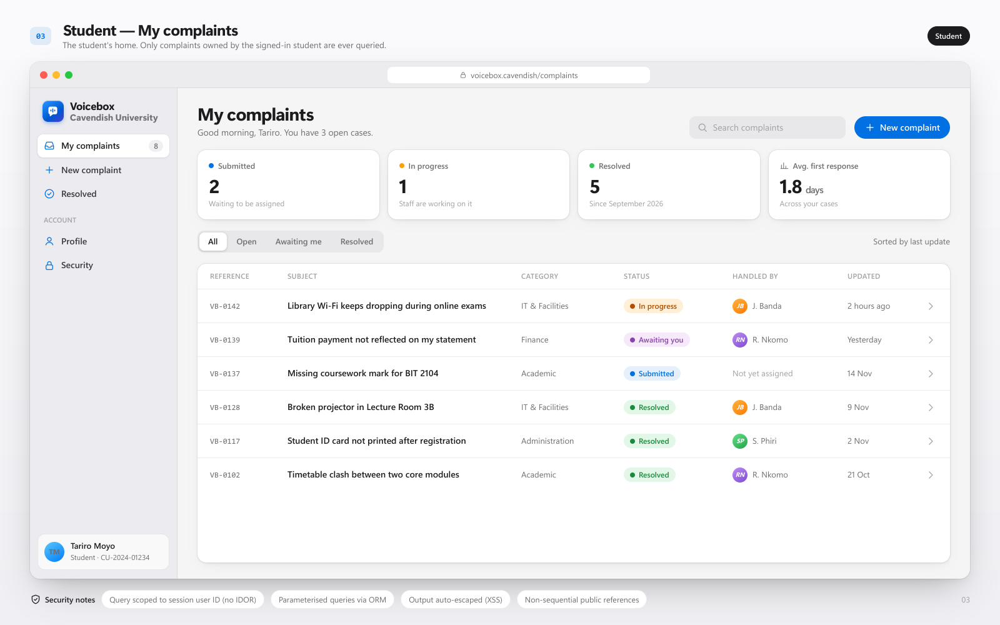
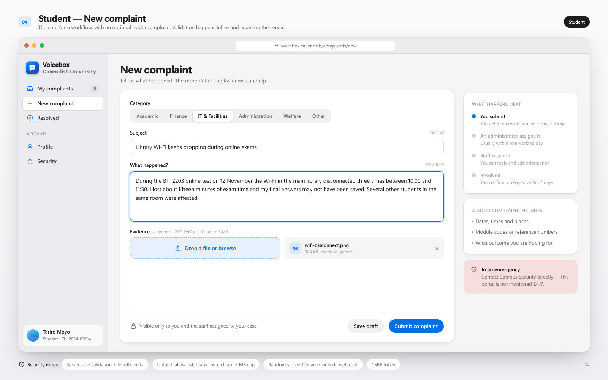
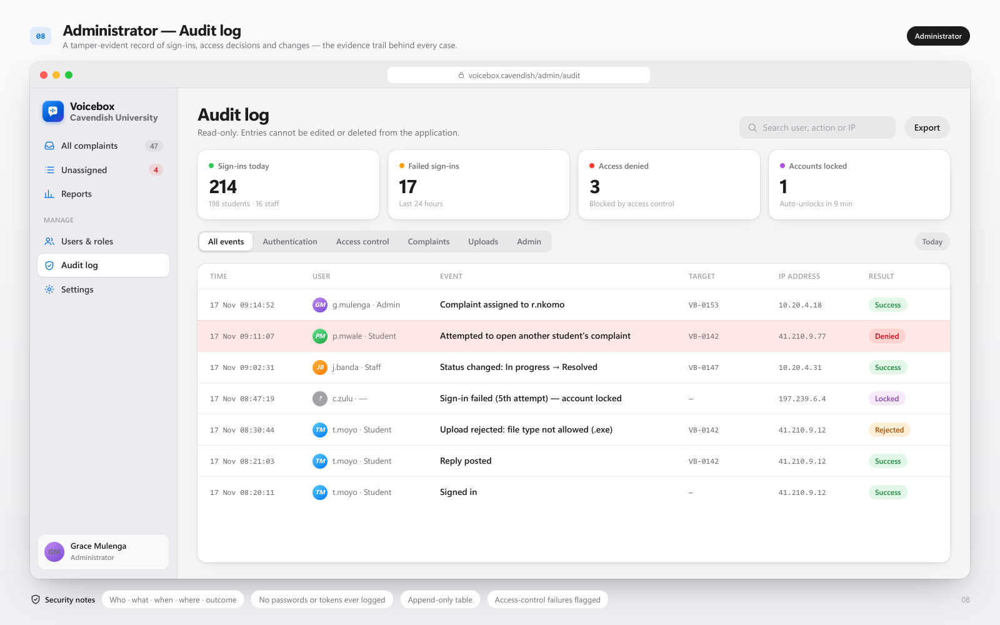
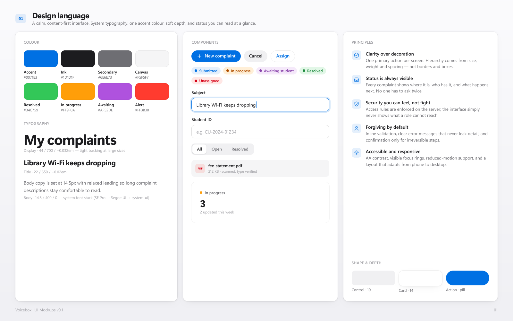
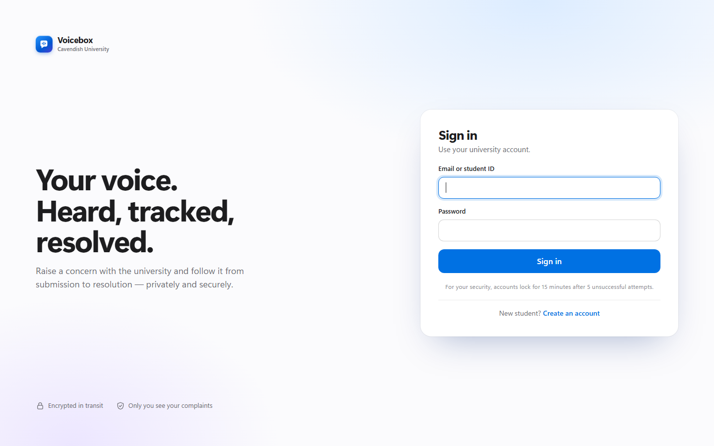

<div align="center">

# Voicebox

**The Student Complaints Portal for Cavendish University**

Every voice heard, every case tracked, every record protected.




</div>

## About

Voicebox is a secure web application that lets students submit and track complaints, lets staff respond to the cases assigned to them, and lets an administrator triage and assign every case.

It is built as a secure-by-design project: the threat model, the security controls and the security tests are part of the work from the first day, not added at the end.

**The one rule the whole system is built around:** a student can only ever see their own complaints.

## Roles

| Role | Can do | Cannot do |
| --- | --- | --- |
| **Student** | Register, submit complaints, attach evidence, reply, track status | See any other student's complaints |
| **Staff** | View and respond to cases assigned to them, change case status | See unassigned cases or cases assigned to others, reassign cases |
| **Administrator** | View all complaints, assign cases to staff, manage users, read the audit log | Edit or delete audit log entries |

## Design

The interface follows Apple's design principles: clarity, deference to content, soft depth, system typography and a single accent colour.

📄 **[Voicebox-Mockups.pdf](docs/Voicebox-Mockups.pdf)** — the full mockup deck (10 pages).

| | |
| --- | --- |
|  **Sign in** |  **New complaint** |
|  **Complaint detail** |  **Staff — assigned cases** |
|  **Administrator — assign cases** |  **Administrator — audit log** |
|  **Design language** |  **Mobile** |

The mockups are written in HTML and CSS ([docs/mockups/voicebox-mockups.html](docs/mockups/voicebox-mockups.html)), so the styles carry straight into the real templates. To rebuild the PDF and previews:

```bash
pip install pymupdf
python scripts/build_mockups.py
```

## Getting started

Requires Python 3.12 or newer.

```bash
python -m venv .venv
```

```bash
.venv\Scripts\activate
```

```bash
pip install -r requirements.txt
```

Copy `.env.example` to `.env` and set `SECRET_KEY` (the file explains how to generate one). Then create the database and start the app:

```bash
flask --app wsgi init-db
```

```bash
flask --app wsgi run
```

Open <http://localhost:5000>. Students create their own accounts on the sign-up page. Staff and administrator accounts are created from the command line, which asks for the password without showing it:

```bash
flask --app wsgi create-user --role admin --email admin@example.com --name "Grace Mulenga"
```

To try all three roles locally, create demo accounts. Each one gets a random passphrase, written to `instance/demo-accounts.txt` (never committed). This command refuses to run in production:

```bash
flask --app wsgi seed-demo
```

Run the tests with:

```bash
python -m pytest
```

## What works today



| Area | Implemented |
| --- | --- |
| Registration | Student sign-up with server-side validation; the role is fixed to Student and never read from the form |
| Passwords | Argon2id hashing; 12-character minimum, common and personal passwords rejected; automatic re-hash when parameters change |
| Sign-in | By e-mail or student ID; one generic failure message; constant work for unknown accounts; lockout for 15 minutes after 5 failures; 10 attempts per minute per IP |
| Sessions | `HttpOnly` + `SameSite=Lax` cookie (`Secure` and `__Host-` prefix in production); fresh session on sign-in; 30-minute idle and 8-hour absolute timeout; sign-out and password change revoke sessions on the server |
| Access control | `login_required` on every private page; `roles_required` decorator returns 403 and logs the attempt; all queries scoped to the signed-in user |
| CSRF | Token on every form, including sign-out (POST only) |
| Security headers | Content-Security-Policy with no inline script or style, `X-Frame-Options`, `nosniff`, `Referrer-Policy`, `no-store` caching, HSTS in production |
| Audit log | Sign-ins, failures, lockouts, registrations, password changes and access denials, with user, IP and outcome; entries cannot be updated or deleted through the ORM; passwords are never logged |
| Configuration | Secrets only from environment variables; the app refuses to start without `SECRET_KEY`; separate development, production and testing settings |
| Complaints | Students submit, reply, withdraw and reopen; staff reply, add internal notes and change status; the administrator assigns and reassigns; each case has a conversation and a timeline |
| Object-level access control | A student sees only their own complaints and staff only the cases assigned to them. Anything else returns 404, identical to a complaint that does not exist, and is written to the audit log |
| File uploads | Extension allow-list (PDF, PNG, JPG), content signature check, 5 MB limit, random stored name, stored outside the web root, downloads go through an authorised route and are always sent as attachments with a sandbox policy |
| Audit log viewer | Administrator-only page with filters, daily counters and highlighted failures |
| Interface | Sign-in, sign-up, role-aware lists, new complaint, complaint detail, security page, admin user list, audit log and error pages, responsive from phone to desktop |

## Technology

| Layer | Choice | Why |
| --- | --- | --- |
| Framework | Flask (Python 3.12) | Small, explicit, easy to audit |
| Database | SQLite in development, PostgreSQL-ready, through SQLAlchemy | Parameterised queries by default |
| Authentication | Flask-Login + Argon2id | Modern password hashing, signed session cookies that can be revoked on the server |
| Forms | Flask-WTF | CSRF protection and server-side validation |
| Templates | Jinja2 | Output auto-escaping against XSS |
| Hardening | Flask-Limiter, hand-written security headers | Rate limiting, CSP and browser protections with no extra dependency |
| Testing | pytest, Bandit, Semgrep, OWASP ZAP | Unit, static, dynamic and manual attack tests |

## Security controls

| Requirement | How Voicebox will address it |
| --- | --- |
| Secure authentication and password storage | Argon2id hashes, password policy, account lockout after 5 failed attempts, generic error messages |
| Secure session management | `HttpOnly`, `Secure`, `SameSite` cookies, session regeneration on login, idle timeout, full logout |
| Server-side access control | Deny by default; role check and ownership check on every route; other users' records return 404 |
| SQL injection protection | ORM and parameterised queries only; no string-built SQL |
| Secure file uploads | Extension allow-list, content (magic byte) check, 5 MB limit, random stored names, files kept outside the web root and served through an authorised route |
| Secrets and configuration | Secrets in environment variables (`.env`, never committed), separate development and production configuration, debug off in production |
| Security logging | Append-only audit log of sign-ins, failures, access denials, uploads and admin actions; no passwords or tokens logged |

## Roadmap

| Day | Date | Focus | Status |
| --- | --- | --- | --- |
| 1 | 17 Nov 2026 | Repository, README, design language and UI mockups | ✅ Done |
| 2 | 18 Nov 2026 | Project skeleton, database models, registration and login, sessions, base layout | ✅ Done |
| 3 | 20 Nov 2026 | Complaint workflow for all three roles, file uploads, access control, audit log viewer | ✅ Done |
| 4 | Next session | Threat model (DFD + STRIDE), Bandit/Semgrep, OWASP ZAP, manual attack tests, reflection | ⏳ Next |

## Build log

### Day 1 — 17 November 2026

- Chose Option A (Student Complaints Portal) and named the system **Voicebox**.
- Defined the three roles and their permissions.
- Defined the design language: colour, typography, components and principles.
- Designed 8 screens across all roles plus mobile, and exported them as a PDF deck.
- Chose the technology stack and mapped each security requirement to a planned control.

### Day 2 — 18 November 2026

- Set up the Flask project: application factory, configuration classes, pinned dependencies and `.env.example`.
- Created the database models: users, complaints, messages, attachments and the audit log.
- Built registration, sign-in, sign-out and password change, with Argon2id hashing, account lockout and rate limiting.
- Built session management: secure cookie flags, idle and absolute timeouts, and server-side session revocation.
- Added the `roles_required` access-control decorator, CSRF protection and security headers with a strict Content-Security-Policy.
- Added the audit log helper and made log entries append-only.
- Turned the mockups into the real base layout, stylesheet and pages, with no inline styles or scripts.
- Wrote 24 automated tests covering authentication, sessions, access control, CSRF, output escaping and the audit log. All pass.

### Day 3 — 20 November 2026

- Built the complaint workflow for all three roles: submit, assign, reply, change status, withdraw and reopen.
- Added object-level access control: one `load_complaint` function guards every complaint route, and a single `permissions` table decides each action.
- Added secure evidence uploads and an authorised download route.
- Added staff-only internal notes that students can never see.
- Added the administrator's audit log viewer with filters and counters.
- Added a `seed-demo` command that creates demo accounts with random passphrases.
- Wrote 29 more tests that replay the manual attacks: opening another student's complaint (IDOR), privilege escalation between roles, mass assignment, SQL injection, stored XSS, and malicious uploads (wrong type, fake content, oversized, path traversal). All 53 tests pass.

## Repository layout

```
Voicebox/
├── app/
│   ├── __init__.py               Application factory, headers, error pages, CLI
│   ├── models.py                 Database models
│   ├── security.py               Hashing, password policy, audit log, access control
│   ├── uploads.py                Upload validation and storage
│   ├── auth/                     Registration, sign-in, sign-out, password change
│   ├── complaints/               Complaint workflow, permissions, downloads
│   ├── main/                     Role-aware lists, user list, audit log viewer
│   ├── templates/                Jinja2 templates
│   └── static/                   Stylesheet and icon
├── tests/                        Automated security tests
├── config.py                     Development, production and testing settings
├── wsgi.py                       Entry point
├── requirements.txt
├── .env.example
├── docs/
│   ├── Voicebox-Mockups.pdf      Mockup deck
│   ├── mockups/                  HTML source of the mockups
│   └── screens/                  PNG preview of each page
├── scripts/
│   └── build_mockups.py          Rebuilds the PDF and previews
└── README.md
```

---

<div align="center"><sub>Voicebox · Secure Web Application Development · Cavendish University · 2026</sub></div>
