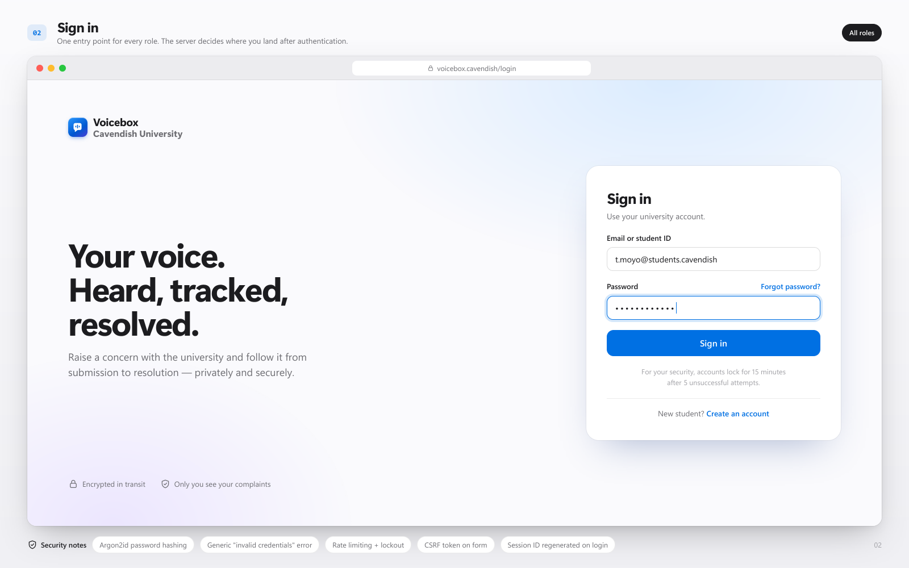
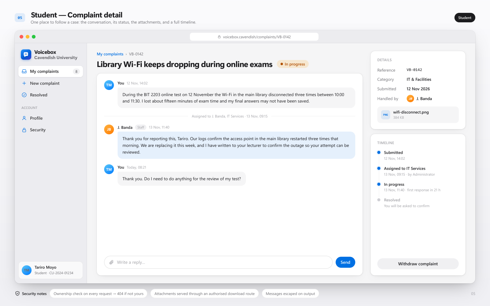
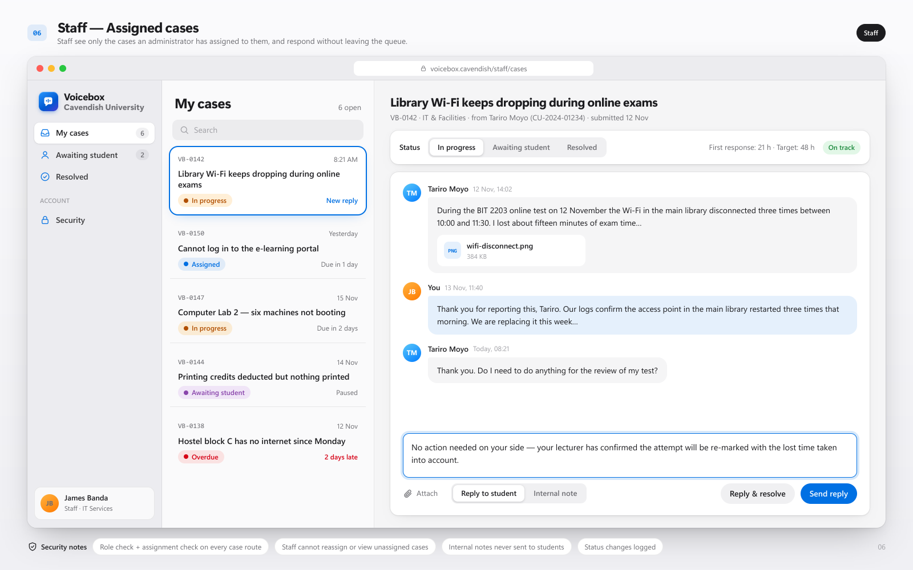
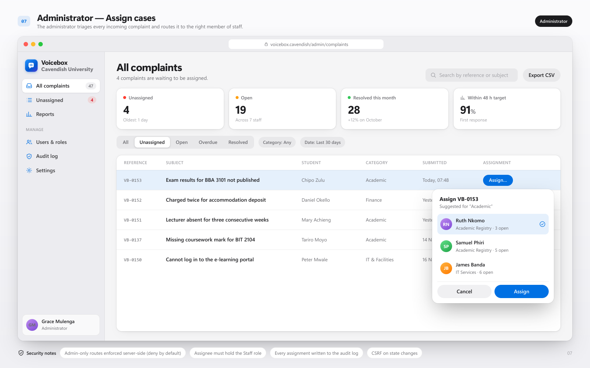
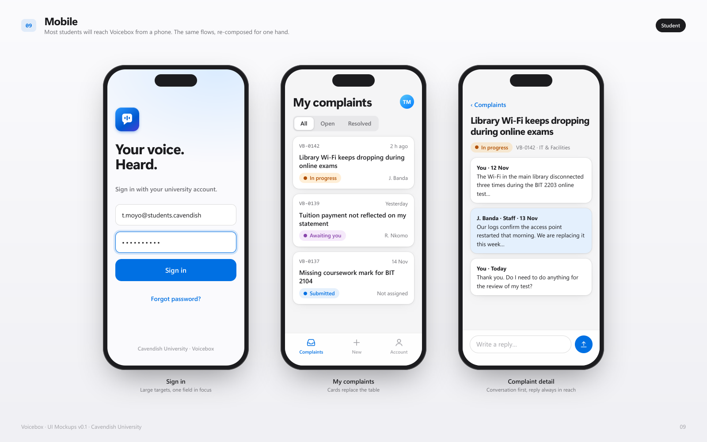

<div align="center">

# Voicebox

**The Student Complaints Portal for Cavendish University**

Every voice heard, every case tracked, every record protected.


</div>

## About

Voicebox is a secure web application that lets students submit and track complaints, lets staff respond to the cases assigned to them, and lets an administrator triage and assign every case.

It is built as a secure-by-design project: the threat model, the security controls and the security tests are part of the work from the first day, not added at the end.

**The one rule the whole system is built around:** a student can only ever see their own complaints.

## Roles

| Role | Can do | Cannot do |
| --- | --- | --- |
| **Student** | Register, submit complaints, attach evidence, reply, track status | See any other student's complaints |
| **Staff** | View and respond to cases assigned to them, change case status | See unassigned cases or cases assigned to others, reassign cases |
| **Administrator** | View all complaints, assign cases to staff, manage users, read the audit log | Edit or delete audit log entries |

## Design

The interface follows Apple's design principles: clarity, deference to content, soft depth, system typography and a single accent colour.

📄 **[Voicebox-Mockups.pdf](docs/Voicebox-Mockups.pdf)** — the full mockup deck (10 pages).

| | |
| --- | --- |
|  **Sign in** |  **New complaint** |
|  **Complaint detail** |  **Staff — assigned cases** |
|  **Administrator — assign cases** |  **Administrator — audit log** |
|  **Design language** |  **Mobile** |

The mockups are written in HTML and CSS ([docs/mockups/voicebox-mockups.html](docs/mockups/voicebox-mockups.html)), so the styles carry straight into the real templates. To rebuild the PDF and previews:

```bash
pip install pymupdf
python scripts/build_mockups.py
```

## Planned technology

| Layer | Choice | Why |
| --- | --- | --- |
| Framework | Flask (Python 3.12) | Small, explicit, easy to audit |
| Database | SQLite in development, PostgreSQL-ready, through SQLAlchemy | Parameterised queries by default |
| Authentication | Flask-Login + Argon2id | Modern password hashing, server-side sessions |
| Forms | Flask-WTF | CSRF protection and server-side validation |
| Templates | Jinja2 | Output auto-escaping against XSS |
| Hardening | Flask-Limiter, Flask-Talisman | Rate limiting, security headers, CSP |
| Testing | pytest, Bandit, Semgrep, OWASP ZAP | Unit, static, dynamic and manual attack tests |

## Planned security controls

| Requirement | How Voicebox will address it |
| --- | --- |
| Secure authentication and password storage | Argon2id hashes, password policy, account lockout after 5 failed attempts, generic error messages |
| Secure session management | `HttpOnly`, `Secure`, `SameSite` cookies, session regeneration on login, idle timeout, full logout |
| Server-side access control | Deny by default; role check and ownership check on every route; other users' records return 404 |
| SQL injection protection | ORM and parameterised queries only; no string-built SQL |
| Secure file uploads | Extension allow-list, content (magic byte) check, 5 MB limit, random stored names, files kept outside the web root and served through an authorised route |
| Secrets and configuration | Secrets in environment variables (`.env`, never committed), separate development and production configuration, debug off in production |
| Security logging | Append-only audit log of sign-ins, failures, access denials, uploads and admin actions; no passwords or tokens logged |

## Roadmap

| Day | Date | Focus | Status |
| --- | --- | --- | --- |
| 1 | 17 Nov 2026 | Repository, README, design language and UI mockups | ✅ Done |
| 2 | 18 Nov 2026 | Project skeleton, database models, registration and login, sessions, base layout | ⏳ Next |
| 3 | 19 Nov 2026 | Complaint workflow for all three roles, file uploads, access control, audit log | ◻️ Planned |
| 4 | 20 Nov 2026 | Threat model (DFD + STRIDE), Bandit/Semgrep, OWASP ZAP, manual attack tests, reflection | ◻️ Planned |

## Build log

### Day 1 — 17 November 2026

- Chose Option A (Student Complaints Portal) and named the system **Voicebox**.
- Defined the three roles and their permissions.
- Defined the design language: colour, typography, components and principles.
- Designed 8 screens across all roles plus mobile, and exported them as a PDF deck.
- Chose the technology stack and mapped each security requirement to a planned control.

## Repository layout

```
Voicebox/
├── docs/
│   ├── Voicebox-Mockups.pdf      Mockup deck
│   ├── mockups/                  HTML source of the mockups
│   └── screens/                  PNG preview of each page
├── scripts/
│   └── build_mockups.py          Rebuilds the PDF and previews
└── README.md
```

---

<div align="center"><sub>Voicebox · Secure Web Application Development · Cavendish University · 2026</sub></div>
